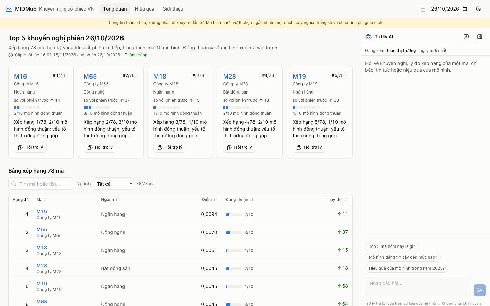
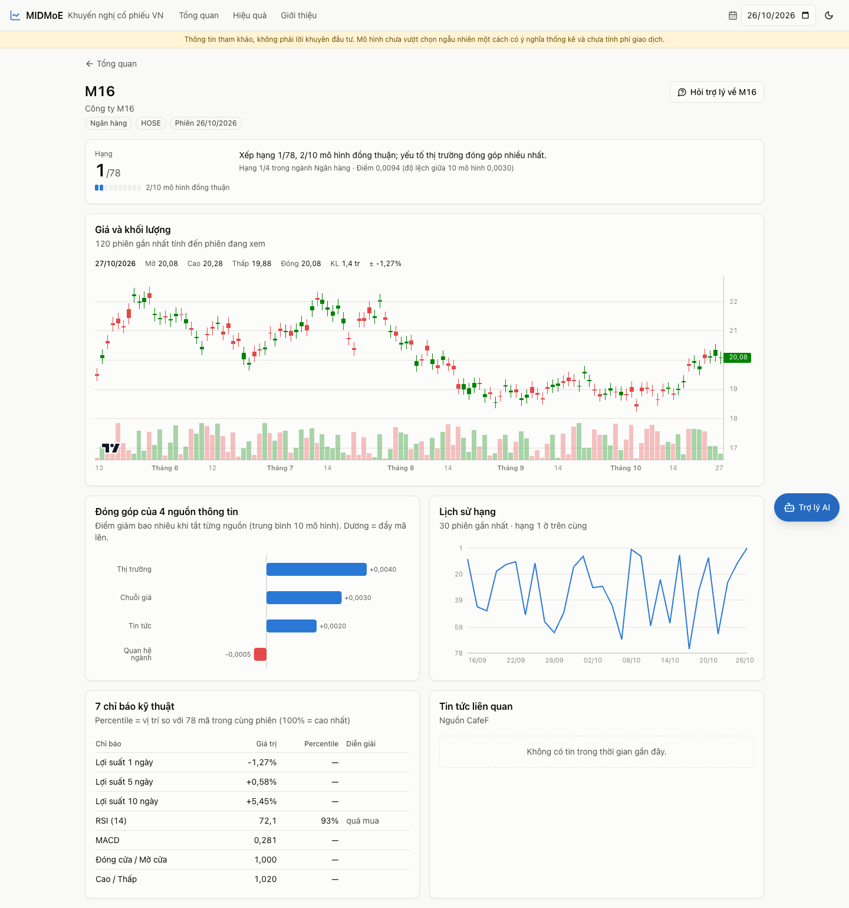
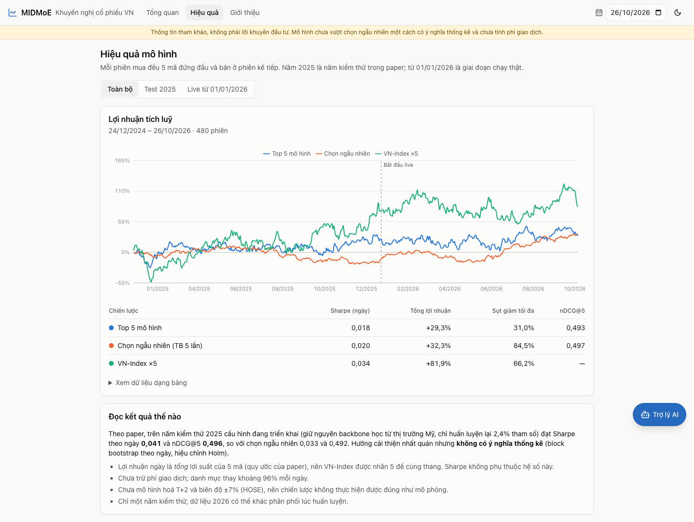
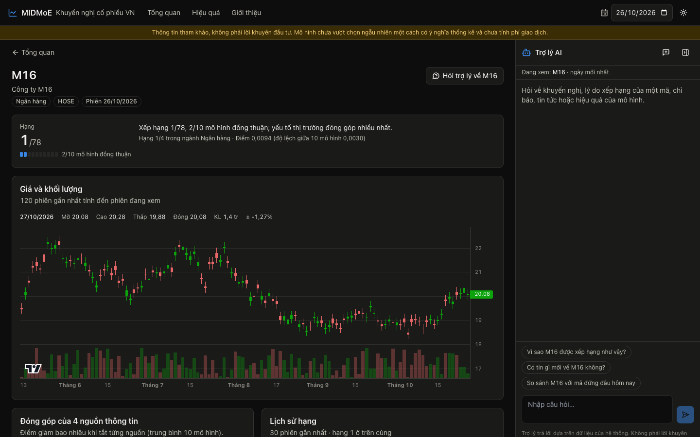
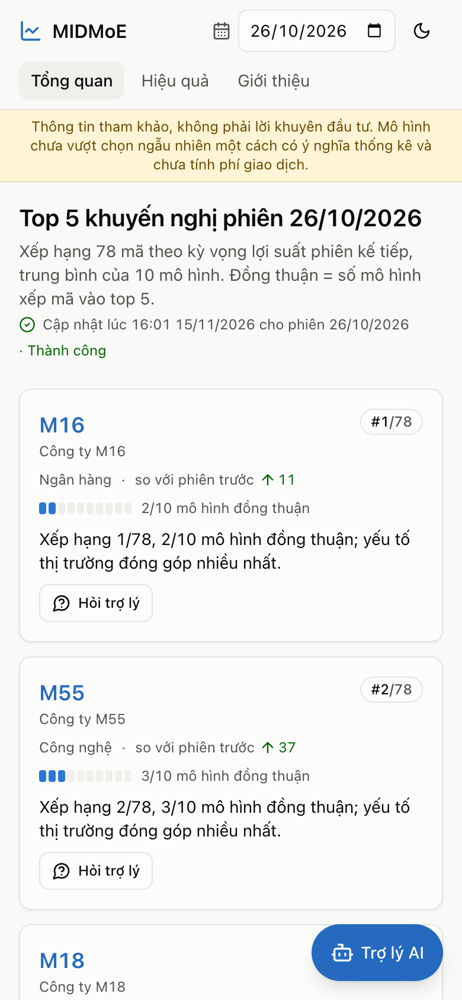
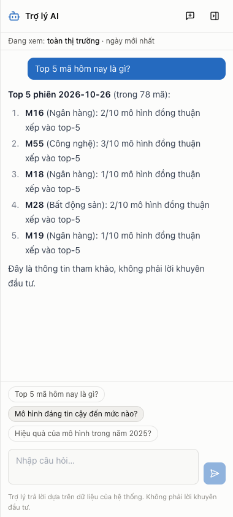
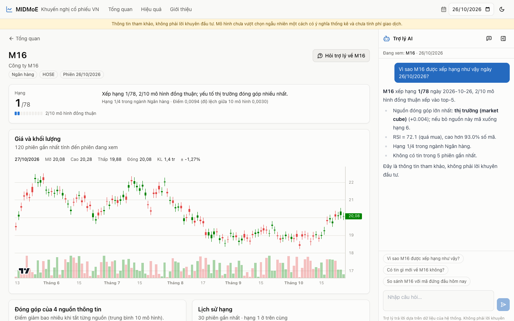

# MIDMoE App — Khuyến nghị cổ phiếu VN + Trợ lý AI

Ứng dụng của đồ án *Hệ thống khuyến nghị đầu tư chứng khoán dựa trên mô hình học sâu phân cấp (MIDMoE) và trợ lý ảo AI*:
pipeline dữ liệu hằng ngày, đóng gói mô hình (ensemble 10 seed), giải thích khuyến nghị, API, trợ lý AI có tool-calling
và web. Kế hoạch chi tiết và tiến độ: [PLAN.md](PLAN.md).

> Thông tin tham khảo, không phải lời khuyên đầu tư. Mô hình chưa vượt chọn ngẫu nhiên một cách có ý nghĩa thống kê
> (xem paper `MIDMoE.pdf`, Table 10).

## Kiến trúc

```
[vnstock]  [CafeF]
    │         │
    ▼         ▼
 scheduler: pipeline/daily_job.py  (16:30 ICT, T2–T6)
    │ fetch → 7 chỉ báo → PhoBERT → normalize → cube → predict (10 seed) → explain
    ▼
 PostgreSQL ◄── api: FastAPI (backend/) ◄── web: Next.js (web/)
                   │
                   └── assistant/ (tool-calling) ──► Gemini / OpenAI / Anthropic
```

| Thư mục | Nội dung |
|---|---|
| `midmoe/` | `MarketMoE` (copy nguyên từ notebook), 7 chỉ báo + chuẩn hoá, `Predictor` (ensemble), metric của paper |
| `pipeline/` | job hằng ngày + scheduler (APScheduler) |
| `backend/` | FastAPI, SQLAlchemy + Alembic, service layer dùng chung cho API và trợ lý |
| `assistant/` | lớp provider LLM, 7 tool, system prompt, bộ eval 50 câu |
| `web/` | Next.js 14 (App Router) + Tailwind, lightweight-charts, Recharts |
| `artifacts/vn/` | weights + tham số chuẩn hoá (không commit, xem [artifacts/README.md](artifacts/README.md)) |
| `notebooks/` | cell export weights để chạy trên Kaggle |

## Trạng thái (15/11/2026)

| Phần | Trạng thái |
|---|---|
| Mô hình (M1) | Đã đóng gói + test; **chờ chạy `notebooks/export_vn_weights.py` trên Kaggle** để có weights |
| Pipeline (M2) | Chỉ báo xong; **chờ notebook `midmoe-vn-cube-build`** (crawl CafeF, PhoBERT, vnstock). `daily_job.run` chưa có |
| Giải thích (M3), dựng cube (M2.5) | Xong, test trên model ngẫu nhiên; chờ weights thật để kiểm tra kết quả |
| API (M4), trợ lý (M5), web (M6), Docker (M7.1) | Xong; đã test trên dữ liệu demo tổng hợp |

Khi pipeline chưa có, scheduler vẫn chạy đúng lịch và ghi một lần chạy `failed` ("chưa được triển khai") để
dashboard hiển thị trạng thái thật.

## Giao diện web

> Ảnh chụp ngày 15/11/2026 trên **dữ liệu demo tổng hợp** (`python -m backend.db.demo`: mã M00–M77, giá và điểm
> sinh ngẫu nhiên). Các con số trong ảnh **không phải kết quả của mô hình**.

Web gồm 4 trang dùng chung một khung: thanh trên cùng (điều hướng, chọn ngày, đổi giao diện sáng/tối), dòng cảnh
báo "không phải lời khuyên đầu tư", và **panel trợ lý AI** cố định bên phải (thu gọn được; trên điện thoại là nút
nổi mở ra toàn màn hình). Ngày đang xem nằm trên URL (`?date=`), nên chia sẻ link vẫn giữ đúng ngày; ngày không có
phiên giao dịch tự lùi về phiên gần nhất trước đó.

### Tổng quan (`/`)



- **5 thẻ top-5** của phiên: mã, ngành, hạng, thay đổi hạng so với phiên trước, **độ đồng thuận** ("2/10 mô hình
  đồng thuận" = số mô hình trong ensemble xếp mã vào top 5), lý do một dòng, nút "Hỏi trợ lý".
- **Bảng 78 mã**: sắp xếp theo từng cột, lọc theo ngành, tìm theo mã/tên.
- **Trạng thái pipeline**: thời điểm cập nhật gần nhất và kết quả (thành công / thiếu dữ liệu / lỗi / không có phiên).

### Chi tiết một mã (`/stocks/[mã]`)



- **Hạng và tóm tắt** lý do, hạng trong ngành, điểm và độ lệch giữa 10 mô hình.
- **Biểu đồ nến + khối lượng** 120 phiên; rê chuột để xem giá mở/cao/thấp/đóng của từng phiên.
- **Đóng góp của 4 nguồn thông tin** (thị trường, chuỗi giá, tin tức, quan hệ ngành): điểm của mã giảm bao nhiêu
  khi tắt từng nguồn, trung bình 10 mô hình. Cột xanh đẩy mã lên, cột đỏ kéo xuống; rê chuột để xem hạng nếu bỏ nguồn đó.
- **Lịch sử hạng** 30 phiên (hạng 1 ở trên cùng), **7 chỉ báo kỹ thuật** kèm percentile so với 78 mã và nhãn diễn
  giải (quá mua / quá bán, top 10%...), **tin tức CafeF** liên quan.

### Hiệu quả mô hình (`/performance`)



- Lợi nhuận tích luỹ của **top 5 mô hình** so với **chọn ngẫu nhiên** và **VN-Index**, chia giai đoạn
  *Test 2025* (năm kiểm thử trong paper) và *Live* (từ `LIVE_START`).
- Bảng Sharpe theo ngày, tổng lợi nhuận, sụt giảm tối đa, nDCG@5; dữ liệu từng phiên mở được dạng bảng.
- Theo quy ước của paper, lợi nhuận ngày là **tổng** lợi suất của 5 mã, nên VN-Index được nhân 5 để cùng thang.
  Trang có đoạn giải thích kết quả và hạn chế (không có ý nghĩa thống kê, chưa tính phí, T+2, biên độ ±7%).

### Giới thiệu (`/about`)

Sơ đồ luồng xử lý của MIDMoE, dữ liệu, hạn chế và link tải paper ([ảnh](docs/screenshots/about.png)).

### Giao diện tối và điện thoại

| Giao diện tối | Điện thoại (390 px) |
|---|---|
|  |  |

Đo bằng Lighthouse (mobile, bản build production chạy local, dữ liệu demo): performance 84–99, accessibility 100,
best practices 100 trên cả 4 trang.

## Trợ lý AI

> Hai ảnh dưới đây chụp với một **LLM kịch bản** chỉ dùng để chụp ảnh (dự án chưa có API key): nó gọi **tool
> thật** trên dữ liệu demo và trình bày lại kết quả. Khi chạy thật, câu trả lời do Gemini/OpenAI/Anthropic viết,
> theo cùng các quy tắc bên dưới.

| Hỏi top 5 hôm nay | Hỏi về mã đang xem (nút "Hỏi trợ lý về M16") |
|---|---|
|  |  |

### Cách hoạt động

```
Người dùng ──► POST /api/chat {message, session_id, context: {ticker, date}}
                 │
                 ▼
          assistant/agent.py ── system prompt (5 quy tắc + ngữ cảnh trang) + 20 tin nhắn gần nhất
                 │
                 ▼
             LLM (Gemini / OpenAI / Anthropic)
                 │  muốn tra cứu?
                 ├──────────► tool ──► service layer ──► PostgreSQL     (lặp tối đa 6 vòng)
                 │◄────────── kết quả JSON
                 ▼
          stream câu trả lời về web (SSE) + lưu chat_sessions / chat_messages
```

- **Chỉ trả lời bằng dữ liệu của hệ thống.** Trợ lý không tự biết số liệu: mọi con số phải lấy từ 7 tool, và các
  tool gọi thẳng service layer của backend (không qua HTTP).

  | Tool | Dùng khi người dùng hỏi |
  |---|---|
  | `get_recommendations` | top-k của một ngày, độ đồng thuận, lý do |
  | `get_stock_explanation` | vì sao một mã có hạng như vậy (4 nguồn, chỉ báo, ngành, tin) |
  | `get_stock_prices` | giá, khối lượng, RSI của N phiên gần nhất |
  | `get_stock_news` | tin tức CafeF của một mã |
  | `compare_stocks` | so sánh 2–5 mã trong cùng ngày |
  | `get_model_performance` | Sharpe, lợi nhuận, sụt giảm của năm 2025 hoặc giai đoạn live |
  | `get_model_info` | mô hình, dữ liệu, kết quả trong paper, hạn chế |

- **Hiểu ngữ cảnh trang.** Web gửi kèm mã và ngày đang xem, nên câu như "mã này thì sao?" hay "hôm đó top 3 là
  gì?" được hiểu đúng. Dòng "Đang xem: M16 · 26/10/2026" trên panel cho biết ngữ cảnh hiện tại.
- **Quy tắc bắt buộc** (trong [assistant/prompts.py](assistant/prompts.py)):
  1. Mọi con số, lý do phải lấy từ kết quả tool; không có dữ liệu thì nói không có.
  2. Không dự đoán giá, không hứa lợi nhuận, không nói "nên mua/bán"; luôn nhắc đây là thông tin tham khảo.
  3. Khi được hỏi độ tin cậy: nói rõ mô hình chưa vượt ngẫu nhiên có ý nghĩa thống kê, chưa tính phí, turnover
     cao, chưa mô hình hoá T+2 và biên độ ±7%.
  4. Giải thích theo thứ tự: hạng + độ đồng thuận → nguồn đóng góp lớn nhất → chỉ báo nổi bật → tin liên quan (có link).
  5. Không nhắc tham số nội bộ (SSAM, DiT...) trừ khi được hỏi về kiến trúc.
- **Mã ngoài danh sách 78 mã** (ví dụ AAPL): tool báo lỗi và trợ lý nói rõ mã không được theo dõi.
- **Giao diện chat**: chữ hiện dần (streaming), dòng "Đang lấy danh sách khuyến nghị…" khi tool đang chạy, câu hỏi
  gợi ý theo trang, nút dừng, nút cuộc trò chuyện mới; lịch sử giữ lại khi tải lại trang.
- **Đổi nhà cung cấp LLM** bằng `LLM_PROVIDER` và `LLM_API_KEY` trong `.env`, không cần sửa code.

### Đánh giá

[assistant/eval/questions.jsonl](assistant/eval/questions.jsonl) có 50 câu (khuyến nghị, giải thích, so sánh, chỉ
báo, tin tức, hiệu quả, câu phải từ chối như "mai giá bao nhiêu / có nên all-in", mã ngoài danh sách, câu dựa vào
ngữ cảnh trang). `python -m assistant.eval.run` tự chấm: số liệu trong câu trả lời có khớp kết quả tool không, câu
cần từ chối có từ chối không, thời gian ra chữ đầu tiên. Ngưỡng đạt theo PLAN: ≥ 95% số liệu khớp, 100% từ chối
đúng chỗ, chữ đầu tiên < 3 giây. **Chưa chạy với LLM thật** (cần API key và dữ liệu đã backfill).

## Chạy bằng Docker Compose

Yêu cầu: Docker 24+ với Compose v2, khoảng 4 GB RAM trống.

```bash
cp .env.example .env              # đặt POSTGRES_PASSWORD, LLM_PROVIDER, LLM_API_KEY
# đặt artifacts vào artifacts/vn/ (tuỳ chọn: thiếu thì API vẫn chạy, chỉ chưa có mã)
docker compose up -d --build
docker compose ps                 # cả 4 service phải "healthy"
```

- Web: http://localhost:3000 · API: http://localhost:8000/docs
- Container `api` tự chạy `alembic upgrade head` rồi nạp bảng `tickers` từ `artifacts/vn/` mỗi lần khởi động.
- `NEXT_PUBLIC_API_URL` được nhúng vào bundle **lúc build**: đổi URL public của API thì phải
  `docker compose build web`.

| Service | Image | Healthcheck |
|---|---|---|
| `db` | `postgres:16-alpine` (volume `pgdata`) | `pg_isready` |
| `api` | `Dockerfile` (Python 3.11, torch CPU) | `GET /api/health` |
| `scheduler` | cùng image với `api` | heartbeat ghi mỗi phút |
| `web` | `web/Dockerfile` (Next.js standalone) | `GET /` |

Lệnh hay dùng:

```bash
docker compose logs -f api scheduler
docker compose exec scheduler python -m pipeline.scheduler --once                   # chạy job hôm nay ngay
docker compose exec scheduler python -m pipeline.scheduler --once --date 2026-11-13
docker compose exec api python -m backend.db.seed                                   # nạp lại tickers
docker compose exec db psql -U midmoe midmoe -c "select * from pipeline_runs order by id desc limit 5"
```

### Backfill lịch sử

`pipeline/backfill.py --from 2025-01-01 --to today` (M2.7) chưa có vì phụ thuộc M2. Khi có:

```bash
docker compose exec scheduler python -m pipeline.backfill --from 2025-01-01 --to today
```

## Chạy local để phát triển

```bash
/opt/anaconda3/bin/python3.11 -m venv --system-site-packages .venv   # hoặc python3.11 bất kỳ
.venv/bin/pip install -r requirements.txt
cp .env.example .env                       # local dùng SQLite: DATABASE_URL=sqlite:///./midmoe.db
.venv/bin/alembic upgrade head
.venv/bin/python -m backend.db.demo        # TUỲ CHỌN: dữ liệu demo TỔNG HỢP (mã M00..M77)
.venv/bin/uvicorn backend.main:app --reload            # :8000

cd web && npm ci && cp .env.local.example .env.local && npm run dev   # :3000
```

`backend.db.demo` nạp dữ liệu ngẫu nhiên nhưng nhất quán để phát triển giao diện; lệnh từ chối chạy nếu DB đã có
mã. **Không dùng dữ liệu này cho demo hay báo cáo.** `LLM_PROVIDER=fake` cho phép thử luồng chat không cần API key.

### Kiểm thử

```bash
.venv/bin/python -m pytest                    # backend, mô hình, trợ lý (parity test tự skip khi thiếu weights)
cd web && npm run lint && npm run typecheck && npm run build
.venv/bin/python -m assistant.eval.run        # eval trợ lý: gọi LLM thật ~50 lượt, cần dữ liệu đã backfill
```

## Biến môi trường

| Biến | Ý nghĩa |
|---|---|
| `POSTGRES_USER` / `POSTGRES_PASSWORD` / `POSTGRES_DB` | Tài khoản PostgreSQL (Compose tự ghép `DATABASE_URL`) |
| `DATABASE_URL` | Chỉ cho chạy local, ví dụ `sqlite:///./midmoe.db` |
| `LLM_PROVIDER` / `LLM_API_KEY` / `LLM_MODEL` | `gemini` (mặc định, model `gemini-3.5-flash`), `openai`, `anthropic`; để trống model = mặc định của provider |
| `ARTIFACT_DIR` | Thư mục weights + tham số (Compose: `/app/artifacts/vn`) |
| `LIVE_START` | Ngày bắt đầu giai đoạn "live" (mặc định 2026-01-01) |
| `TZ` | `Asia/Ho_Chi_Minh` |
| `NEXT_PUBLIC_API_URL` | URL API **mà trình duyệt gọi** |
| `CORS_ORIGINS` | Origin của web được gọi API, phân tách bằng dấu phẩy |
| `API_PORT` / `WEB_PORT` | Cổng publish trên host |

## Deploy lên VPS (D4)

1. VPS Ubuntu 22.04+, 2 vCPU / 4 GB RAM trở lên; cài Docker Engine + Compose plugin.
2. `git clone` repo, chép `artifacts/vn/` lên (scp), tạo `.env` với mật khẩu mạnh và key LLM.
3. Đặt URL public: `NEXT_PUBLIC_API_URL=https://api.<domain>`, `CORS_ORIGINS=https://<domain>`.
4. Đặt reverse proxy có HTTPS (ví dụ Caddy) trước cổng 3000 và 8000. Với API cần tắt buffering để SSE của
   `/api/chat` không bị gom lại (Caddy: `flush_interval -1`; nginx: `proxy_buffering off`).
5. `docker compose up -d --build`, sau đó chạy backfill, rồi theo dõi 3 phiên liên tiếp (M7.4) qua
   `pipeline_runs` hoặc dòng trạng thái trên dashboard.

## Tài liệu

- [PLAN.md](PLAN.md): spec, milestone, tiến độ
- [docs/NEXT_STEPS.md](docs/NEXT_STEPS.md): việc còn lại và hướng dẫn từng bước trước demo
- [artifacts/README.md](artifacts/README.md): định dạng artifacts và cách export từ Kaggle
- `MIDMoE.pdf`: paper draft
